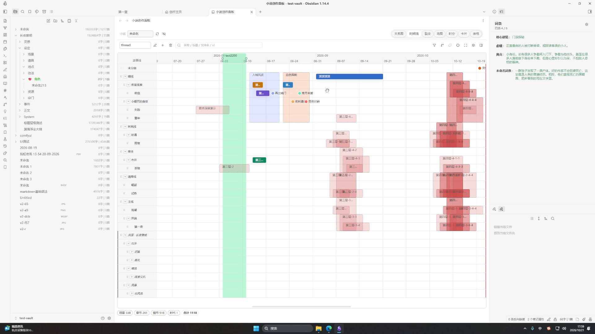
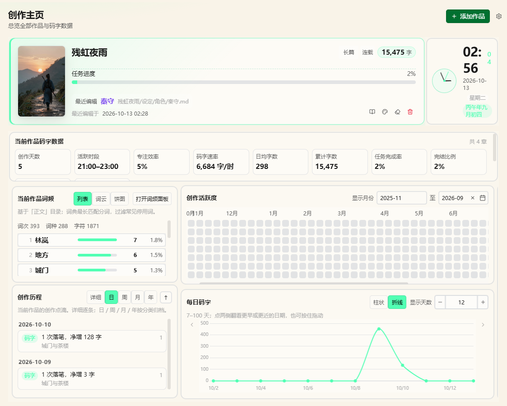
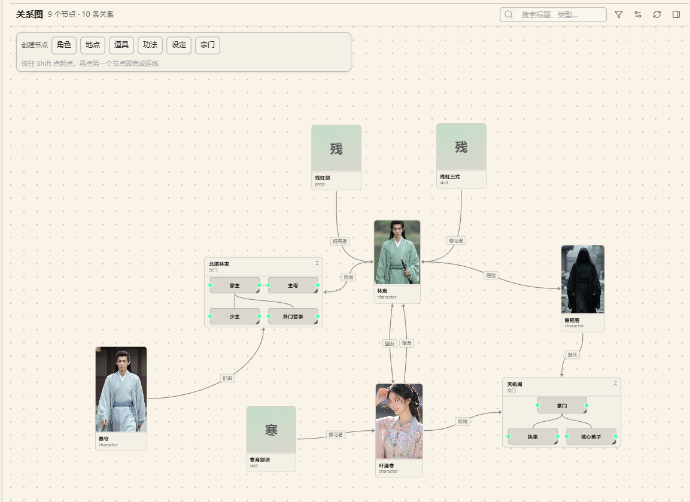
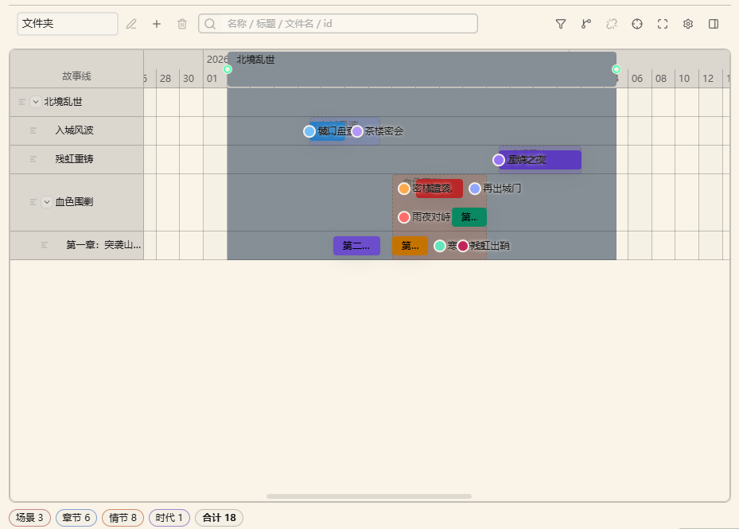
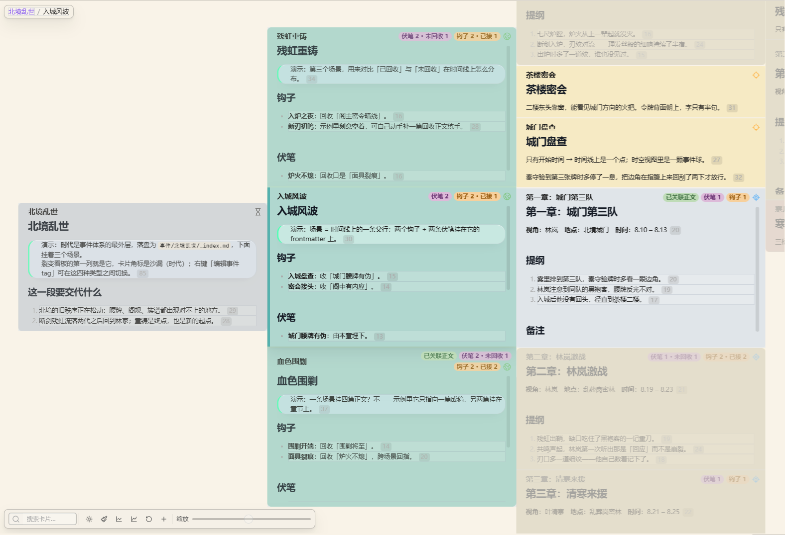
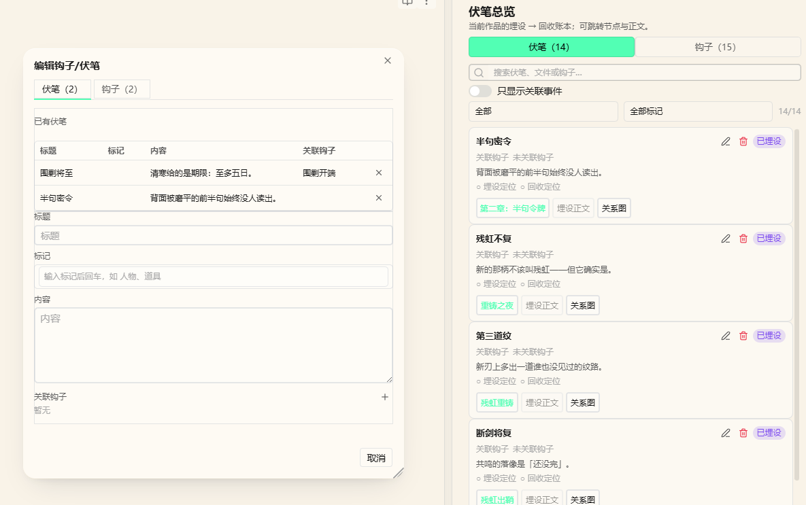

<a id="english"></a>

<div align="center">

# ✍️ Novel-kit

**[中文](README-CN.md)** | **English**


An all-in-one writing suite for long-form web novels in Obsidian.

One work is one folder in your vault · Settings, outlines and manuscripts are all plain Markdown · Seven views over the same notes.

<a href="pages/index.html">`📘 User Guide`</a>

<a href="docs/reference.en.md">`📖 Full Reference`</a>

<a href="docs/reference.en.md#troubleshooting">`❓ FAQ`</a>

## 📺 Tutorial video

[](https://www.bilibili.com/video/BV1Kfn66mETt/)

**Click the cover to open it on Bilibili** (about 91 minutes): an offline writing companion with about 20 features — highlighting, timeline, word count, history replay, proofreading and more.Watch it together with the `System/示例导览.md` walkthrough written by **"Load sample"** — that is the fastest way in.



</div>

> \[!IMPORTANT]
>
> **This plugin is built for the desktop version — desktop only.**

## ✨ Feature Highlights

### 🏠 Creative Homepage

<sub>Progress & KPIs · Daily word-count curve and heatmap · Word frequency · Todos · Clock · Drag to add or remove widgets, layout saved to System/home.json</sub>


### 🕸️ Graph

<sub>Visualizes relations plus foreshadowing / hooks · "Filter" decides what shows and what gets highlighted · "Display config" handles file types, colors and edges</sub>



### 📅 Timeline

<sub>Scenes ordered by time · With "Folder" grouping, dragging really moves files · Edit start/end dates straight in the frontmatter · Toolbar "Play timeline" steps through events in chronological order</sub>



### 🧬 Fission

<sub>Multi-column card outline · Drag to reorder plot beats · Cards *are* the notes — you are editing the same files · Right-click to retag the event kind (era / scene / chapter / plot)</sub>



### 🗺️ Map & Spacetime

<sub>Coordinate markers on a base image · Spacetime maps the image to a plane and time to the z axis · Coordinates read "map name：x，y" (full-width colon and comma)</sub>


### 🃏 Cards & Table

<sub>Cards form a configurable field wall · Table supports grouping, filtering, pinning columns and in-place editing · Both support drag ordering and cross-group drag</sub>


### 🧩 Inline views in notes (code blocks)

<sub>Write a `novel-timeline` / `novel-table` / `novel-cards` code block in any note to render a fully interactive view inline · Data comes from the work that owns the note · Display config is saved per block, so one block never changes another block or the panel</sub>

````markdown
```novel-table
height: 560
```
````

The commands "Insert timeline / table / card view block" drop a ready-made block at the cursor. Height is `height: 560` (200–1600); edits inside a block only rewrite that block's own `config: {...}` line.

### 🧵 Foreshadowing · Hooks · Plot · Manuscript

<sub>The main operation happens in the prose: select a sentence → right click → plant or resolve; state walks through Unplanted → Planted → Linked → Resolved</sub>



### 📝 Creative Assistants

| **Inspiration Cards** Drag into graph / timeline / fission to become plot beats           | **Glossary** Quick lore lookup, organized in layers                     | **Word Frequency** See your habits and repeats at a glance |
| ----------------------------------------------------------------------------------------- | ----------------------------------------------------------------------- | ---------------------------------------------------------- |
| **Proofreading** In-place checks, confirm each fix                                        | **Writing Goal** Daily targets and progress nudges                      | **Naming** Generate character and place names by style     |
| **File Templates** Auto-apply a template and rename by "target folder + filename pattern" | **History Snapshots** Auto-archived, side-by-side diff before restoring | **Sticky Notes** Jot things down, auto-saved               |

### 🖥️ Desktop

**This plugin is desktop only**: every feature is designed around desktop interactions (the manifest declares `isDesktopOnly`).

## 📥 Installation

| Method                                | Steps                                                                                                            |
| :------------------------------------ | :--------------------------------------------------------------------------------------------------------------- |
| **Community plugins** *(recommended)* | Settings → Community plugins → Browse → search `novel-kit` → install and enable                                  |
| **Manual**                            | Put `main.js`, `manifest.json` and `styles.css` into `<your vault>/.obsidian/plugins/novel-kit/`, then enable it |

Requires Obsidian 1.8.7 or later; **desktop only** (the plugin uses Node / Electron APIs).

## 🚀 Quick Start

1. **Register a work**: open the creative homepage and click "New work", or run the command "Register novel workspace". The folders `设定/`, `事件/`, `正文/`, `灵感/` and `System/` are created for you.
2. **Try the sample** (optional): when no work exists yet, the panel top shows **"Load sample"**, which writes *《残虹夜雨》* — 1 era (北境乱世), 3 scenes and 6 outline sections, 4 manuscript chapters, 14 clues (8 resolved, 6 deliberately left open to demo filtering), one "北境" map with four coordinates, 4 inspiration cards, 2 sticky notes, plus two Chinese walkthrough notes. Following the tour is the fastest way in.
3. **Start writing**: draft under `正文/`, select sentences to plant foreshadowing and hooks; open the main panel (book icon in the ribbon) when you want the whole picture.
4. **Embed a view** (optional): run "Insert timeline / table / card view block" to drop an interactive view straight into a note; each block keeps its own display config inside its code block.

<details>

<summary>`🎯 Key Commands`</summary>

| Command                     | Description                                 |
| :-------------------------- | :------------------------------------------ |
| Register novel workspace    | Register a folder in your vault as a work   |
| Switch active work          | Move between registered works               |
| Open novel panel            | Open the main panel with all seven views    |
| Open creative homepage      | Open the dashboard homepage                 |
| Load sample                 | Write the sample work 《残虹夜雨》                |
| Insert view block           | Timeline / table / card block at the cursor |
| New / Resolve foreshadowing | Plant and resolve on the current selection  |
| Toggle writing mode         | Desktop: typewriter scrolling               |

See the [commands section of the reference](docs/reference.en.md#commands).

</details>

<details>

<summary>`⚙️ Key Settings`</summary>

| Setting       | Default     | Description                                                          |
| :------------ | :---------- | :------------------------------------------------------------------- |
| Default view  | Graph       | Which view opens first in the panel                                  |
| View layout   | By viewport | Multi-column on wide screens; single column + tabs on narrow screens |
| Stop words    | Built-in    | Words ignored by word-frequency counting                             |
| Auto snapshot | On          | Whether notes are archived automatically                             |
| CSS snippets  | Off         | Desktop: inject custom styles into the vault                         |

See the [settings section of the reference](docs/reference.en.md#settings).

</details>

## ❓ FAQ

If a work won't open, it's usually one of three things: **it isn't registered** (click "New work" first), **it isn't selected at the top of the panel**, or **the** **`正文/`** **path is wrong** (write under the `正文/` of a registered work).

Notes missing from the graph is usually "Only show connected" hiding nodes with no relations — turn that off, or add a relation; if a whole category is missing, tick its file type under "Filter" or "Display config" in the toolbar.

Markers missing on the map: check that coordinates read "map name：x，y" (**full-width colon and comma**) and that the map's enabled types include `locale`. If a timeline edit doesn't stick, change the "开始" / "结束" fields directly in the note's frontmatter.

Word counts not adding up usually means the homepage counts manuscripts in the **currently active work** — confirm the right work is selected, then refresh.

More Q\&A in the [reference FAQ](docs/reference.en.md#troubleshooting).

## 💾 Data

Settings, outlines and manuscripts are all Markdown notes in your vault. The plugin only maintains two extra things:

- **Plugin** **`data.json`** (`.obsidian/plugins/novel-kit/data.json`): the work list, the active work, and global settings. Deleting it loses registrations and settings and **touches no notes**.
- **Per-work** **`System/*.json`**: view layouts, filter rules, homepage templates, todos, sticky notes. Deleting one only resets that slice of view configuration.

## 🌐 Network use

**The plugin works fully offline**, collects no telemetry, and never uploads your notes. Only the two features below reach the network, and only when you trigger them yourself — there are no background requests:

| Feature                                    | When it goes online                                    | Service it contacts                                                 |
| :----------------------------------------- | :----------------------------------------------------- | :------------------------------------------------------------------ |
| Word-frequency / proofreading dictionaries | When you click "Download" for a dictionary in settings | `cdn.jsdelivr.net` (jieba dictionaries), `www.mdbg.net` (CC-CEDICT) |
| Homepage web-table widget                  | When you enter a URL and click "Fetch"                 | The URL you entered                                                 |

Both only **download** data to your machine (dictionaries are saved to `.obsidian/plugins/novel-kit/word-freq-dicts/`); nothing of yours is sent out. Word frequency still works without downloading a dictionary — only the built-in stop-word list is available and segmentation is less accurate.

## ⚖️ Disclosures

- **No telemetry**: there is no client-side telemetry and no background network requests (network use is limited to the two cases in the previous section).
- **Open source**: the full source is in this repository, released under the [Apache-2.0 License](LICENSE).

## 🛠️ Development

Requires Node.js 18 or later. `npm install`, then `npm run dev` to develop (output goes to `test-vault/.obsidian/plugins/novel-kit/`), and `npm run build` for a production bundle in `build/`.

After making changes:

```bash
npm test              # vitest: homepage templates / sample data / style rules
npm run check         # svelte-check type checking
npm run visual:check  # visual regression (run npm run build first)
npm run lint          # Biome
```

The entry point is `src/main.ts`; each feature lives in its own `src/features/<name>/` folder (`manager.ts` + `appView.ts` + `settings.ts`), and only `css-snippets` and `export` are desktop-only. See the [reference's development notes](docs/reference.en.md#development).

<div align="center">

## 📄 License & 💬 Feedback

[Apache-2.0 License](LICENSE) · [NOTICE](NOTICE)

### Third-party components

This plugin bundles and uses the following open-source projects, with thanks (copyright notices retained as their licences require):

| Component                                                      | Licence      | Copyright                                               |
| :------------------------------------------------------------- | :----------- | :------------------------------------------------------ |
| [three.js](https://github.com/mrdoob/three.js)                 | MIT          | © 2010–2024 three.js authors                            |
| [Chart.js](https://github.com/chartjs/Chart.js)                | MIT          | © 2014–2024 Chart.js Contributors                       |
| [3d-force-graph](https://github.com/vasturiano/3d-force-graph) | MIT          | © Vasco Asturiano                                       |
| [MiniSearch](https://github.com/lucaong/minisearch)            | MIT          | © Luca Ongaro                                           |
| [jsdiff](https://github.com/kpdecker/jsdiff)                   | BSD-3-Clause | © 2009–2015 Kevin Decker <<kpdecker@gmail.com>>         |
| [relation-graph](https://github.com/seeksdream/relation-graph) | MIT          | © seeksdream                                            |
| [CC-CEDICT](https://cc-cedict.org/)                            | CC BY-SA 4.0 | © CC-CEDICT project (downloaded on demand, not bundled) |

### 📮 Contact

**QQ group:** **`431076635`** — bug reports, questions and suggestions are all welcome.

⭐ Star · 🐛 [Issues](https://github.com/moke525/obsidian-svelte-plugin-2026-8/issues)

**Happy writing!** ✍️

</div>

<div align="center">

## 💗 Support

If you like this plugin and want to support the author to keep updating, you can buy the author a bubble tea here!

|                                WeChat Pay                                |                               Alipay                              |
| :----------------------------------------------------------------------: | :---------------------------------------------------------------: |
|  |  |

</div>
