<a id="中文"></a>

<div align="center">

# ✍️ Novel-kit

**中文** | **[English](README.en.md)**

[](https://community.obsidian.md/plugins/novel-kit)
[](https://community.obsidian.md/plugins/novel-kit)
[](https://github.com/moke525/obsidian-novel-kit/releases/latest)
[](manifest.json)
[](LICENSE)

为长篇网文与小说写作打造的 Obsidian 一站式写作套件。<br />
一部作品就是库里的一个文件夹 · 设定 / 大纲 / 正文全是明文 Markdown · 七个视图看同一批笔记。

<br />

<a href="docs/reference.zh-CN.md"><kbd>📖 完整参考</kbd></a>
<a href="docs/reference.zh-CN.md#常见问题"><kbd>❓ 常见问题</kbd></a>

<br />

<br />

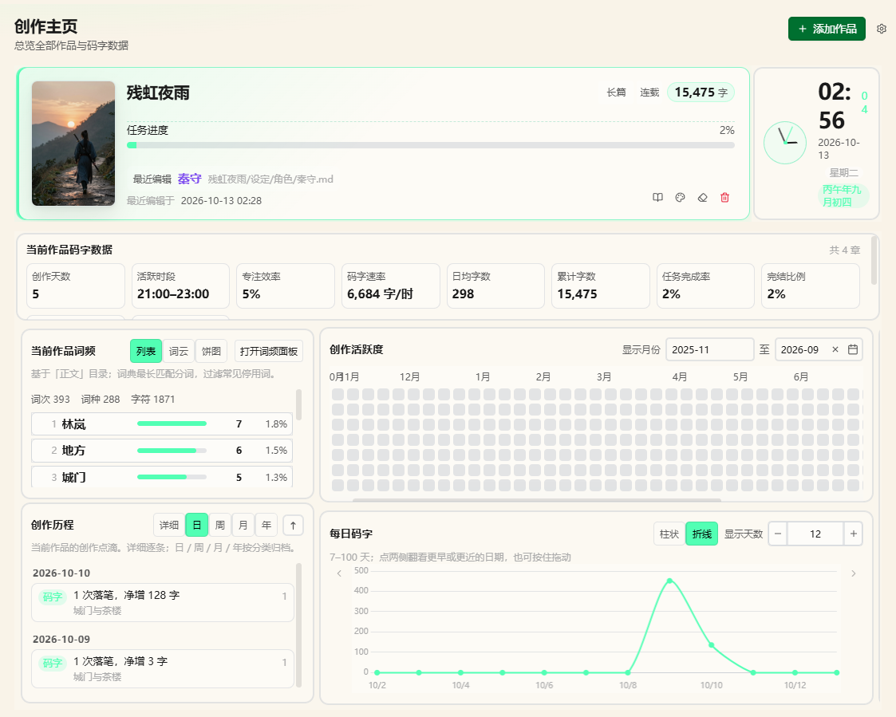

</div>

> [!IMPORTANT]
> **本插件基于桌面版开发，仅支持桌面端。**

<br />

## ✨ 功能一览

### 🏠 创作主页
<sub>进度与 KPI · 每日码字曲线与热力图 · 词频 · 待办 · 时钟 · 组件可拖动增删，布局写进作品的 System/home.json</sub>


### 🕸️ 关系图
<sub>关系与伏笔 / 钩子的可视化 · 「筛选」管哪些文件显示与特殊样式 · 「显示配置」管文件类型、配色与连线</sub>

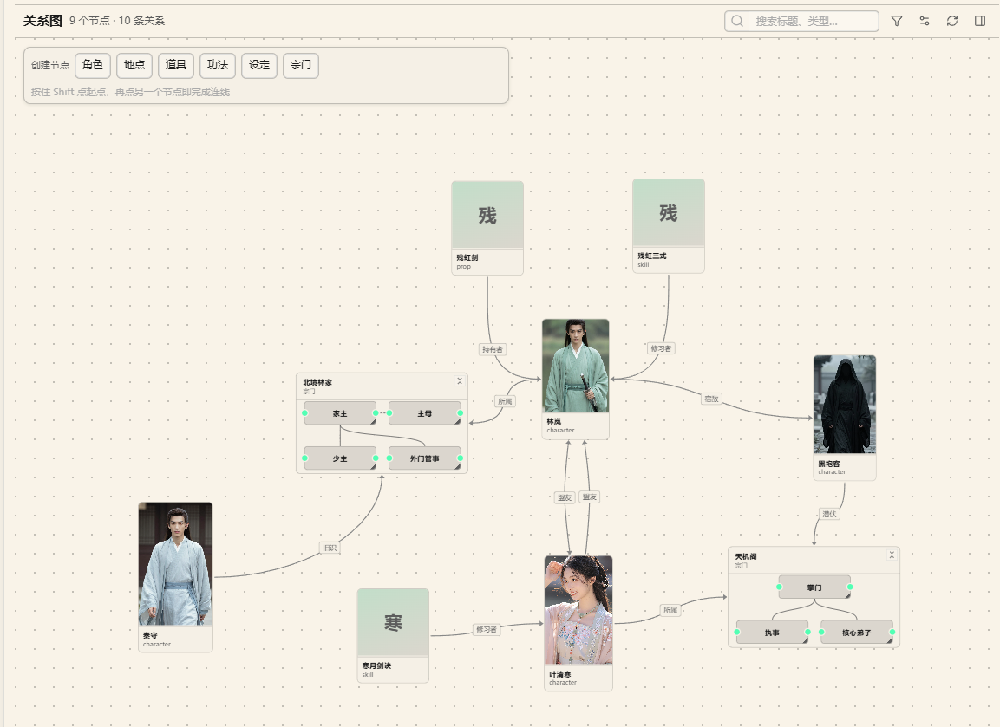

### 📅 时间线
<sub>按时间排场景 · 分组选「文件夹」时拖动会真的移动文件 · 起止日期直接改 frontmatter</sub>

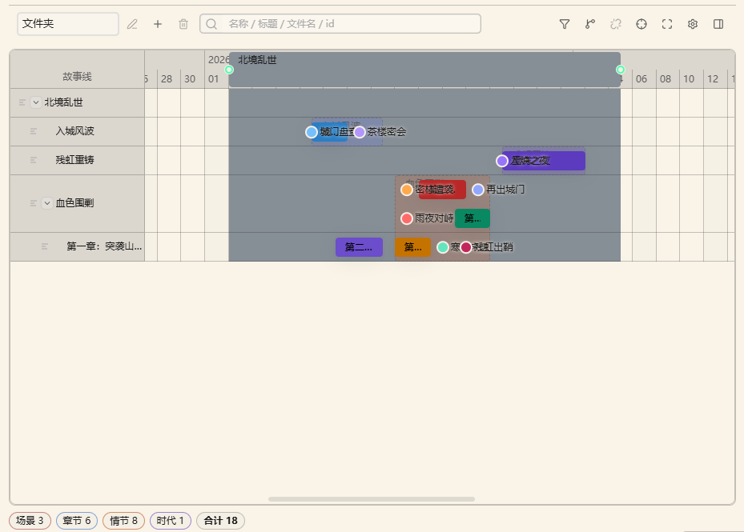

### 🧬 裂变
<sub>多列卡片大纲 · 拖动调整情节顺序 · 卡片就是笔记，改的是同一份文件 · 右键改事件类型（时代 / 场景 / 章节 / 情节）</sub>

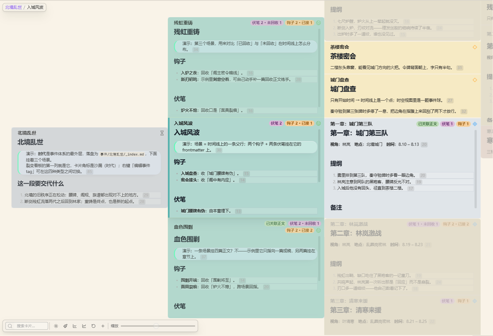

### 🗺️ 地图与时空
<sub>底图打坐标标记 · 时空把地图当平面、时间当 z 轴 · 坐标写成「地图名：x，y」（全角冒号与逗号）</sub>

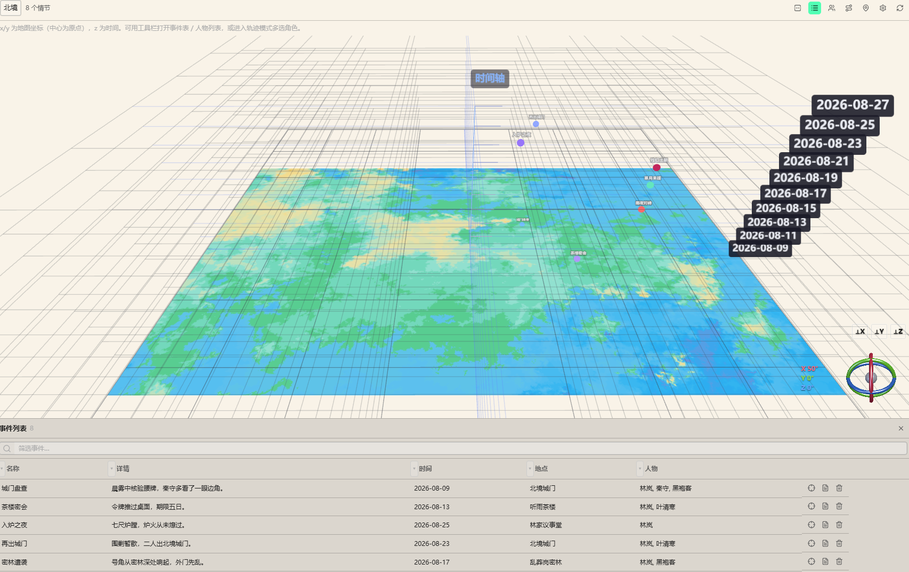

### 🃏 卡片与表格
<sub>卡片是可配置的字段墙 · 表格能分组、过滤、钉列、就地改字段 · 两者都支持拖拽排序与跨组拖拽</sub>


### 🧵 伏笔 · 钩子 · 剧情 · 正文
<sub>主操作全在正文里：框选句子 → 右键 → 埋设 / 回收，状态一路走 未埋设 → 已埋设 → 已关联 → 已回收</sub>

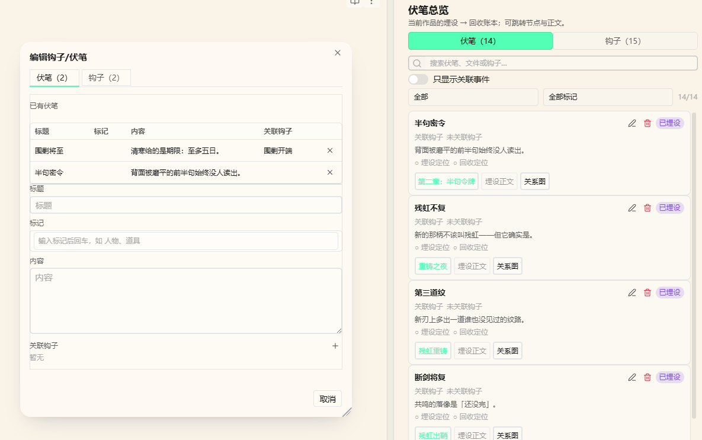

### 📝 创作辅助工具

<table>
<tr>
<td width="33%" align="center" valign="top">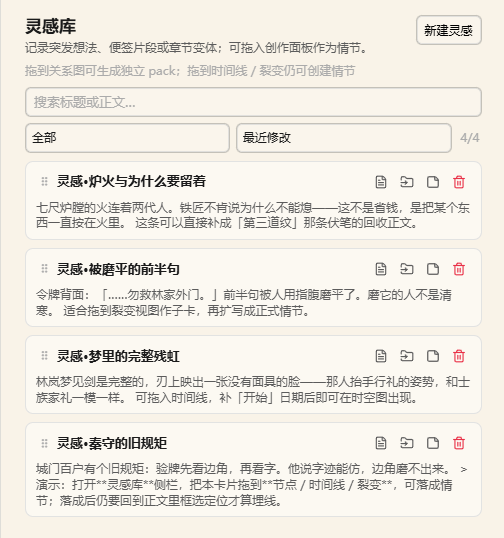<br /><b>灵感卡片</b><br /><sub>可直接拖进关系图 / 时间线 / 裂变变成情节</sub></td>
<td width="33%" align="center" valign="top">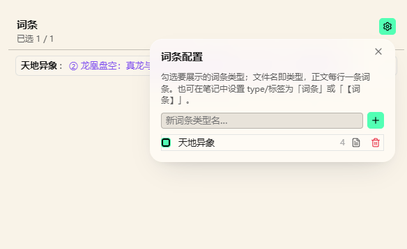<br /><b>词条</b><br /><sub>设定速查，按层级组织</sub></td>
<td width="33%" align="center" valign="top">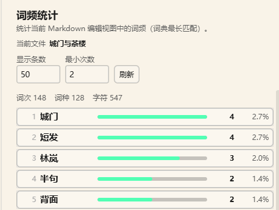<br /><b>词频</b><br /><sub>统计正文用词，看出偏好与重复</sub></td>
</tr>
<tr>
<td width="33%" align="center" valign="top">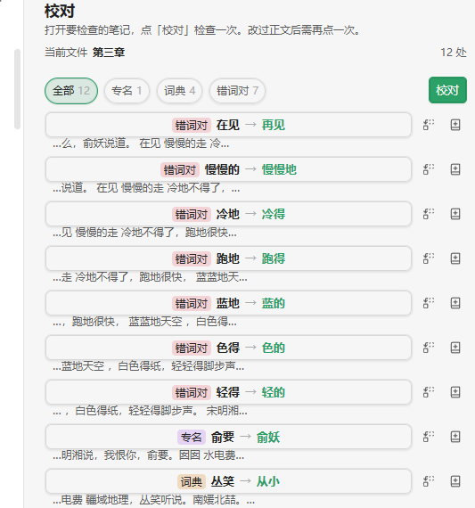<br /><b>校对</b><br /><sub>就地检查，逐条确认修改</sub></td>
<td width="33%" align="center" valign="top">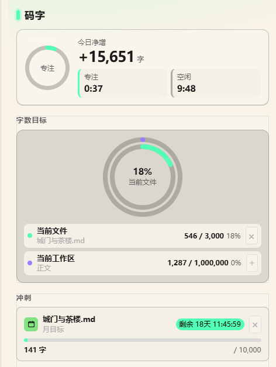<br /><b>码字目标</b><br /><sub>每日目标与进度提醒</sub></td>
<td width="33%" align="center" valign="top">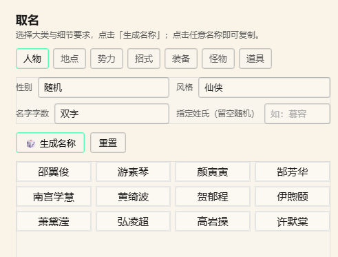<br /><b>取名</b><br /><sub>按风格生成角色与地名</sub></td>
</tr>
<tr>
<td width="33%" align="center" valign="top">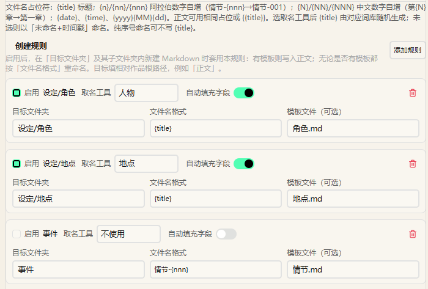<br /><b>文件模板</b><br /><sub>按「目标文件夹 + 文件名格式」自动套模板并重命名</sub></td>
<td width="33%" align="center" valign="top">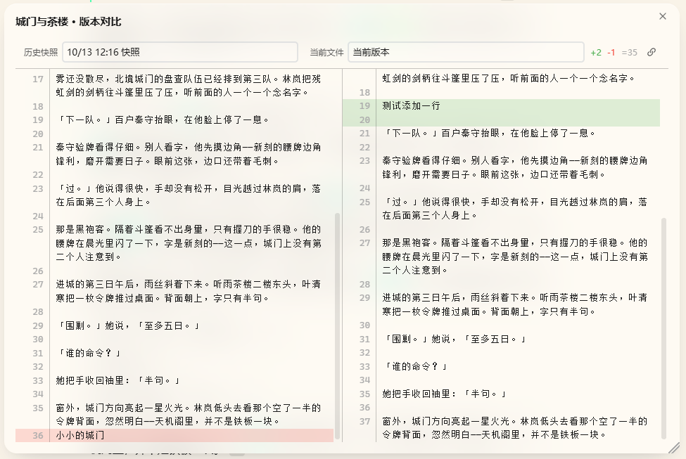<br /><b>历史快照</b><br /><sub>自动存档，恢复前能左右对比</sub></td>
<td width="33%" align="center" valign="top">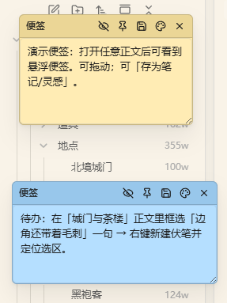<br /><b>悬浮便签</b><br /><sub>随手记，自动保存</sub></td>
</tr>
</table>

### 🖥️ 桌面端

**本插件仅支持桌面端**：全部功能按桌面交互设计（manifest 已声明 `isDesktopOnly`）。

## 📥 安装

| 方式 | 步骤 |
|:-----|:-----|
| **社区插件市场** *(推荐)* | 设置 → 第三方插件 → 浏览 → 搜索 `novel-kit` → 安装并启用 |
| **手动安装** | 把 `main.js`、`manifest.json`、`styles.css` 放进 `<你的 vault>/.obsidian/plugins/novel-kit/`，再在设置里启用 |

需要 Obsidian 1.8.7 或更高版本；**仅桌面端**（插件用到了 Node / Electron API）。

## 🚀 快速开始

1. **注册一部作品**：打开创作主页点「新增作品」，或运行命令「注册小说工作区」。文件夹里会自动铺好 `设定/`、`事件/`、`正文/`、`灵感/`、`System/`。
2. **先看示例**（可选）：库里一部作品都没有时，创作面板顶部会出现 **「加载示例」**，写入一部《残虹夜雨》——1 个时代（北境乱世）、3 个场景与 6 段大纲、4 篇成稿、14 条线索（8 条已回收、6 条刻意不回收用来演示筛选）、一张「北境」地图与四处坐标、4 张灵感卡片、2 张悬浮便签，外加两份中文说明书。跟着导览走一遍最快。
3. **开始写**：在 `正文/` 下写稿，框选句子埋伏笔与钩子；需要看全局时再打开小说创作面板（Ribbon 书本图标）。

<details>
<summary><kbd>🎯 主要命令</kbd></summary>

<br />

| 命令 | 说明 |
|:-----|:-----|
| 注册小说工作区 | 把库里的某个文件夹登记为一部作品 |
| 切换激活作品 | 在已注册的作品之间切换 |
| 打开小说创作面板 | 打开七个视图所在的主面板 |
| 打开创作主页 | 打开仪表盘主页 |
| 加载示例 | 写入示例作品《残虹夜雨》 |
| 新建伏笔 / 回收伏笔 | 在正文选区上埋设与回收 |
| 切换写作模式 | 桌面端：打字机居中滚动 |

完整清单见 [参考手册的命令部分](docs/reference.zh-CN.md#命令清单)。

</details>

<details>
<summary><kbd>⚙️ 主要设置</kbd></summary>

<br />

| 设置 | 默认值 | 说明 |
|:-----|:-------|:-----|
| 默认视图 | 关系图 | 打开创作面板时先看哪个视图 |
| 视图布局 | 按视口 | 宽屏用多层分栏；窄屏用单列 + 页签 |
| 词频停用词 | 内置 | 统计词频时忽略的词 |
| 自动快照 | 开 | 是否自动为笔记存档 |
| CSS 片段 | 关 | 桌面端：把自定义样式注入库 |

完整设置项见 [参考手册的设置部分](docs/reference.zh-CN.md#插件设置)。

</details>

## ❓ 常见问题

一部作品看不起来，通常是这三件事：**没注册作品**（先「新增作品」）、**创作面板顶部没选中它**、或者 **`正文/` 路径不对**（要在已注册作品的 `正文/` 下写作）。

关系图里找不到笔记，默认是因为「仅显示有关联」把没有关系的节点藏了起来——关掉该选项，或给它加一条关联；整类不显示则去工具栏的「筛选」或「显示配置」勾选文件类型。

地图上看不到标记，检查笔记里的坐标写成「地图名：x，y」（**冒号与逗号都是全角**），且地图的显示类型包含 `locale`。时间线改了没生效，直接去改笔记 frontmatter 里的「开始」「结束」。

字数与今日进度对不上，多半是主页统计的是**当前作品工作区**里的正文，先确认选中了正确的作品再刷新。

更多问答见 [参考手册的常见问题](docs/reference.zh-CN.md#常见问题)。

## 💾 数据

设定、大纲与正文都是你自己 vault 里的 Markdown 笔记。插件只额外维护两份东西：

- **插件 `data.json`**（`.obsidian/plugins/novel-kit/data.json`）：作品列表、当前激活作品、全局设置。删掉会丢掉注册信息与设置，**碰不到任何笔记**。
- **作品 `System/*.json`**：视图布局、筛选规则、主页模板、待办、悬浮便签等。删掉其中一份只重置那一小块视图配置。

## 🌐 网络使用

**插件本身完全离线可用**，不收集任何遥测数据，不上传你的笔记。只有下面两个功能会在你主动触发时联网，除此之外没有任何后台请求：

| 功能 | 何时联网 | 访问的服务 |
|:-----|:---------|:-----------|
| 词频 / 校对的分词词典 | 在设置里点「下载」某个词典时 | `cdn.jsdelivr.net`（jieba 词典）、`www.mdbg.net`（CC-CEDICT） |
| 主页的网页表格组件 | 你填入网址并点「获取」时 | 你填的那个网址本身 |

两者都只**下载**数据到本地（词典存进 `.obsidian/plugins/novel-kit/word-freq-dicts/`），不会把你的内容发出去。不下载词典也能用词频功能——只有内置停用词表可用，分词精度会低一些。

## ⚖️ 合规披露

- **不收集遥测**：没有任何客户端遥测，也没有任何后台联网请求（联网只发生在上一节的两种情形）。
- **开源**：完整源码见本仓库，以 [Apache-2.0 License](LICENSE) 发布。

## 🛠️ 开发

需要 Node.js 18 或更高版本。`npm install` 后用 `npm run dev` 开发（产物写入 `test-vault/.obsidian/plugins/novel-kit/`），`npm run build` 出生产包到 `build/`。

改动之后跑一遍：

```bash
npm test              # vitest：主页模板 / 示例数据 / 样式规约
npm run check         # svelte-check 类型检查
npm run visual:check  # 视觉回归（需先 npm run build）
npm run lint          # Biome
```

入口在 `src/main.ts`，每个功能模块各占 `src/features/<名>/` 一个文件夹（`manager.ts` + `appView.ts` + `settings.ts`），其中只有 `css-snippets` 与 `export` 是桌面专属。详见 [参考手册的开发说明](docs/reference.zh-CN.md#开发说明)。

<br />

<div align="center">

## 📄 许可证 & 💬 反馈

[Apache-2.0 License](LICENSE) · [NOTICE](NOTICE)

### 第三方组件

本插件打包并使用了下列开源项目，在此致谢（按各自许可证要求保留版权声明）：

| 组件 | 许可证 | 版权 |
|:-----|:-------|:-----|
| [three.js](https://github.com/mrdoob/three.js) | MIT | © 2010–2024 three.js authors |
| [Chart.js](https://github.com/chartjs/Chart.js) | MIT | © 2014–2024 Chart.js Contributors |
| [3d-force-graph](https://github.com/vasturiano/3d-force-graph) | MIT | © Vasco Asturiano |
| [MiniSearch](https://github.com/lucaong/minisearch) | MIT | © Luca Ongaro |
| [jsdiff](https://github.com/kpdecker/jsdiff) | BSD-3-Clause | © 2009–2015 Kevin Decker &lt;kpdecker@gmail.com&gt; |
| [relation-graph](https://github.com/seeksdream/relation-graph) | MIT | © seeksdream |
| [CC-CEDICT](https://cc-cedict.org/) | CC BY-SA 4.0 | © CC-CEDICT project（词典由用户按需下载，不打包） |

⭐ Star · 🐛 [提交问题](https://github.com/moke525/obsidian-novel-kit/issues)

<br />

## 💗 支持 / Support

如果你喜欢这个插件，并愿意支持作者继续努力更新，你可以在这里请作者喝一杯奶茶！

If you like this plugin and want to support the author to keep updating, you can buy the author a bubble tea here!

| 微信 / WeChat Pay | 支付宝 / Alipay |
|:---:|:---:|
|  |  |

<br />

**祝你写作愉快！** ✍️

</div>
